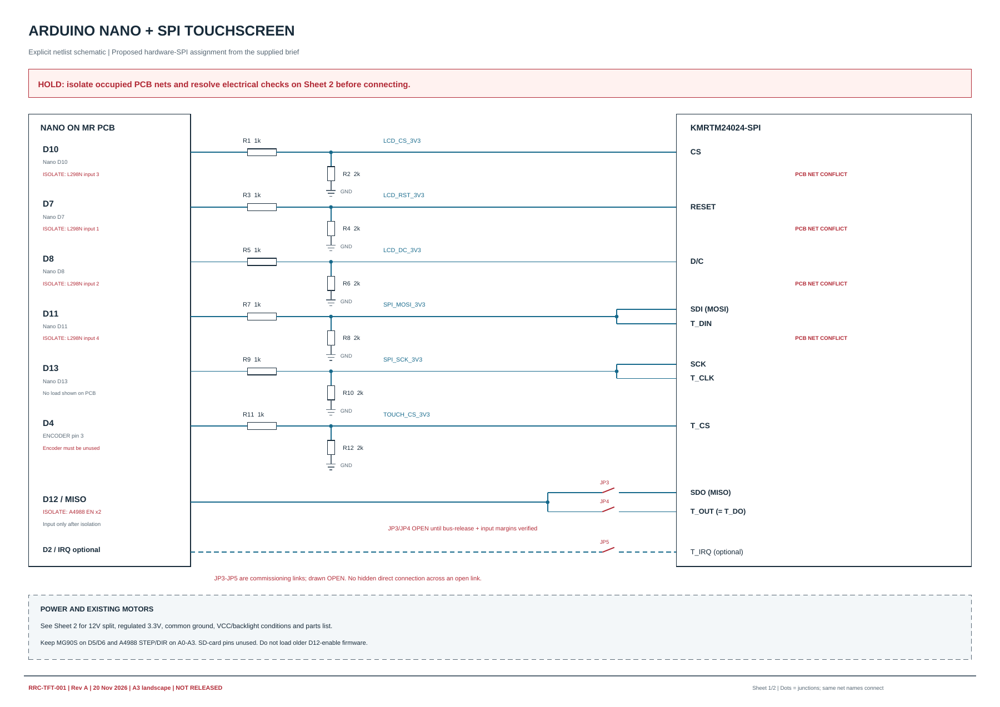
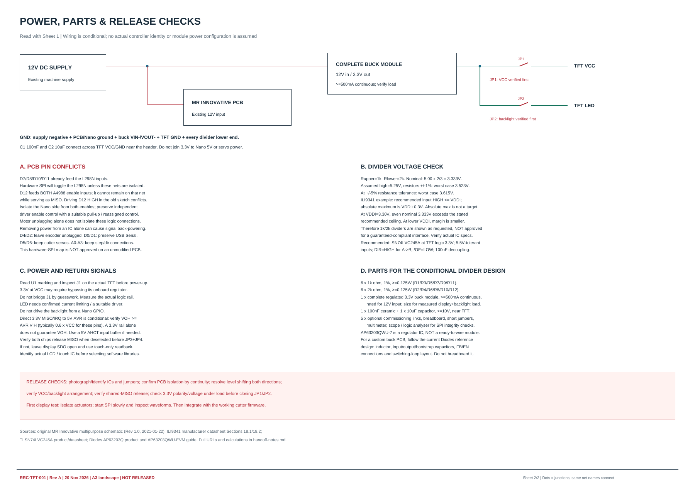

# Resistor Reel Cutter

Arduino Nano on the original MR Innovative controller PCB, with two MG90S cutter servos.

## TFT wiring documentation — revision A

**Conditional reference design — not approved for wiring or power-up on an unmodified controller PCB.**

- [Download the complete wiring package (ZIP)](docs/tft-wiring/Nano-TFT-wiring-package.zip?raw=true)
- [Download the two-sheet A3 wiring diagram (PDF)](docs/tft-wiring/Nano-TFT-wiring-A3.pdf?raw=true)
- [Read the parts list, electrical checks and assembly notes](docs/tft-wiring/handoff-notes.md)
- [Signal drawing (SVG)](docs/tft-wiring/signal-schematic-A3.svg)
- [Power and checks (SVG)](docs/tft-wiring/power-and-checks-A3.svg)
- [Connection table (CSV)](docs/tft-wiring/connections.csv)
- [Explicit netlist (JSON)](docs/tft-wiring/connection-netlist.json)
- [Validation report](docs/tft-wiring/validation-report.json)

The supplied brief's hardware-SPI allocation conflicts with existing L298N and A4988 connections. The documentation records those conflicts, the required isolation checks, unresolved module power/backlight details, and signal-level limits. Six 1k/2k dividers are illustrated as requested, but are not guaranteed compliant with the display's input ratings. A suitable logic buffer is recommended. Do not mix this map with the earlier software-SPI proposal.

### Preview





### Reproduce the drawings

Use Python 3 with ReportLab and Liberation Sans fonts installed. From the repository root:

```sh
python -m pip install reportlab
python docs/tft-wiring/build_wiring.py
```

The generator writes the PDF, SVGs, netlist and validation files to `./output`. PNG previews and ZIP packaging are supplied artifacts, not regenerated by that script. The script checks net membership and drawing wire intersections; those checks do not validate unseen physical hardware.

Servo testing and calibration have been performed by the builder. Actual simultaneous cutting acceptance and TFT electrical verification remain to be confirmed. No firmware is included in this documentation upload.
