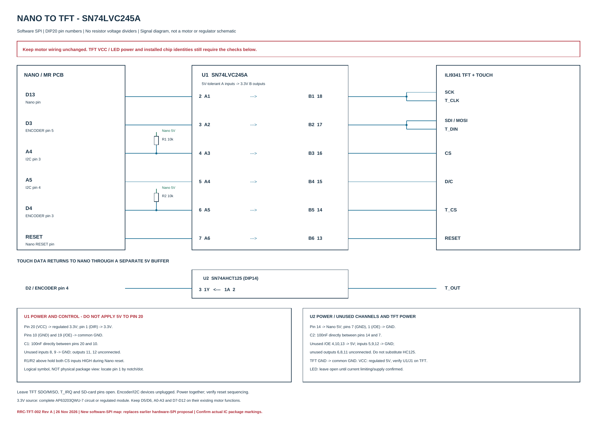

# Simple Nano / TFT buffer wiring

[Download the A3 PDF](Nano-TFT-SN74LVC245A.pdf?raw=true) · [SVG](Nano-TFT-SN74LVC245A.svg) · [Netlist](connections.json)

This is the latest software-SPI interface allocation. It preserves existing servo and motor-control pins. **Do not combine it with the older hardware-SPI diagram.** The SN74LVC245A replaces all voltage-divider pairs.

- U1: SN74LVC245A, DIP20, 3.3V supply, A-to-B direction. Six channels drive clock, MOSI, display CS, D/C, touch CS, and reset. Clock/MOSI each branch after their one buffer channel.
- U2: SN74AHCT125, DIP14, 5V supply, one channel returns touch data to Nano D2. The global direction of U1 cannot independently reverse a single channel.
- R1/R2: 10k pull-ups to Nano 5V on the two chip-select inputs; **not voltage dividers**.
- C1/C2: 100nF bypass capacitors at the two buffer ICs.
- TFT SDO/MISO, T_IRQ and SD-card pins are intentionally unused.
- TFT power regulator/jumper, backlight current limiting, actual controller identities and startup sequencing remain physical checks. Do not close unverified backlight connections. Regulated 5V at TFT VCC follows the supplied seller specification; inspect onboard U1/J1 before powering.
- 3.3V source is the complete selected AP63203QWU-7 circuit or a complete converter module, **not a bare IC wired as a module**. Never connect 5V to the LVC245A VCC pin. Power the interface together and check for unintended supply backfeed.
- The diagram shows logical pin functions with physical DIP pin numbers; it is not a top-view chip placement drawing. Locate pin 1 from the actual package notch/dot. Verify the part is LVC245A, not HC245/HCT245, and that the return buffer is AHCT125.

For reproduction, run `python draw_diagram.py` with Python 3, ReportLab and Liberation Sans fonts installed. The script emits PDF, SVG and the explicit connection netlist next to itself; the PNG is a rendered preview.

Checks performed: every pin on one net, six correct down-conversion channels, motor-control pins untouched, no different-net wire crossings. These checks do not replace inspection of actual hardware.

Primary pinout references: [TI SN74LVC245A](https://www.ti.com/lit/ds/symlink/sn74lvc245a.pdf), [TI SN74AHCT125](https://www.ti.com/lit/ds/symlink/sn74ahct125.pdf).
